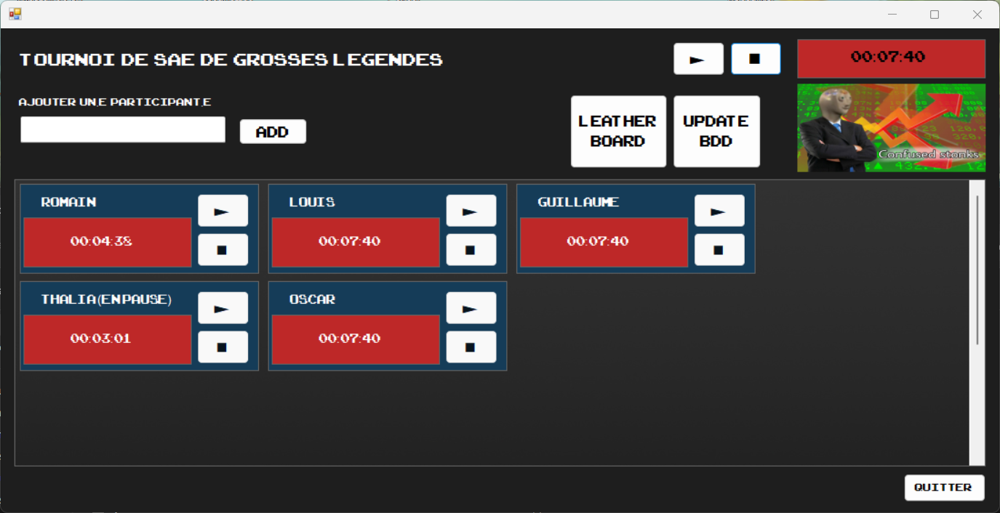
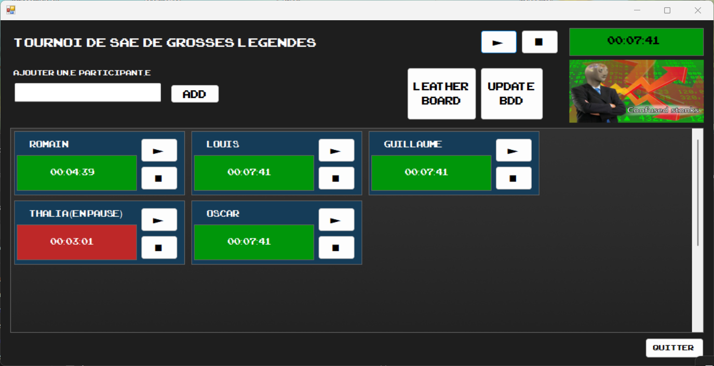
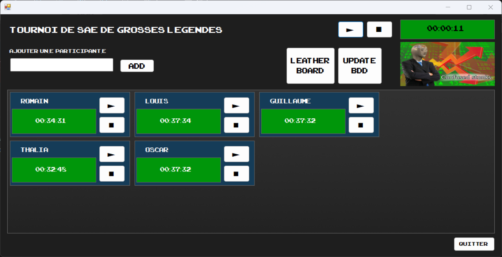
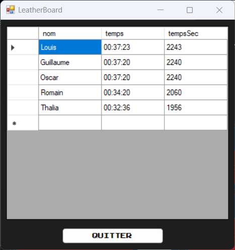

<p align="center"></p>

# Chronos Tournoi SAE

> *Un projet personnel codé à l'occasion d'un tournoi, lors d'une LAN organisée au sein de l'IUT Robert Schuman.* 

<details>
<summary>Image utilisée pour la communication du tournoi</summary>
<p align="center"></p>
</details>

---
## Présentation du projet

**Chronos Tournoi SAE** est un petit programme codé en C#, .NET et SQLite pour arbitrer un tournoi lors d'une soirée LAN de notre BUT informatique. Le tournoi était parodique : la LAN se tenait juste avant les rendus de plusieurs projets tutorés et les étudiants étaient globalement en retard, mais voulaient quand même participer à la LAN.<br>
Pour pouvoir concilier les impératifs de travail et les besoins sociaux des étudiants, j'ai organisé un tournoi où l'objectif était de travailler le plus longtemps possible, sur nos révisions et projets respectifs.<br>
Les règles du tournoi sont :
- les participants sont regroupés dans une salle dédiée, le tournoi débute à 19 h 30
- le but est de cumuler le plus de temps de travail
- lorsqu'un étudiant prend une pause ou quitte la salle pour une raison ou une autre, son compteur de temps est suspendu
- le compteur de temps reprend lorsque l'étudiant retourne à son travail
- le lendemain à 7 h, le tournoi prend fin

Le temps de travail était comptabilisé pour chaque étudiant via ce petit programme, exécuté pendant toute la soirée par un PC dédié.

<br>

| Informations           |                                           |
|------------------------|-------------------------------------------|
| Durée de développement | 2 h, en juin 2026                                        |
| Taille de l'équipe     | projet développé seul                     |
| Technologies utilisées | langages : C#, SQL <br>frameworks et bibliothèques : WinForms (.NET Framework 4.7.2), SQLite <br>outils : Visual Studio    |

<br>

<p align="center"><i>Fenêtre principale de l'application</i></p>
<p align="center"></p>

---
## Description des fonctionnalités

### Base de données

La base de données SQLite a une structure basique : elle comporte une table "participants" qui contient deux colonnes.

| Colonne | Type | Description |
|---|---|---|
| `nom` | TEXT (clé primaire, unique) | Nom du participant |
| `temps` | INTEGER | Temps enregistré (en secondes) |

---
### Décompte du temps

#### Compteurs individuels
Chaque participant possède son propre compteur de temps, qui comptabilise les secondes passées au travail. Le compteur individuel peut se mettre en pause et se relancer en fonction de l'activité de l'étudiant.<br>
Les temps individuels sont sauvegardés dans une base de données, mise à jour à chaque fermeture du programme, manuellement via le bouton "update BDD" et toutes les 10 minutes de façon automatique.<br>
#### Compteur global
Un compteur global chronomètre le temps global du tournoi et peut lui aussi être mis en pause, ce qui mettra en pause tous les participants. Quand on relance le compteur global, les compteurs individuels des participants sont relancés (sauf ceux qui étaient déjà en pause).<br>
Le temps global n'est pas sauvegardé et sert uniquement à suivre l'avancée du tournoi.
#### Au démarrage de l'application
A l'ouverture, la base de données est consultée et le programme ajoute un par un les participants présents dans la base puis positionne leur compteur de temps à la dernière valeur enregistrée. Cette fonctionnalité est prévue en cas de crash ou d'interruption du programme pour relancer rapidement le tournoi.<br>
Le compteur global est remis à zéro à chaque lancement de l'application (l'application est supposée tourner pendant toute la durée du tournoi).<br>
L'application a été conçue pour n'être utilisée qu'une fois, ainsi, pour lancer un tournoi distinct d'un tournoi précédent, il faut effacer manuellement toutes les lignes de la table participants.

---
### Gestion des participants

Il n'y a pas de possibilité de suppression d'un participant : une fois inscrit, son nom figurera dans la base de données ainsi que son temps. <br>
Pour l'ajout, l'utilisateur doit saisir un nom pour le participant qu'il souhaite ajouter. Le nom étant la clé primaire de la table "participants", le programme empêche d'ajouter deux participants ayant le même nom.

<details>
<summary>Captures d'écran de l'application en fonctionnement</summary>
<p align="center"><i>Le tournoi mis en pause</i></p>
<p align="center"></p>
<p align="center"><i>Reprise du tournoi</i></p>
<p align="center"></p>
<p align="center"><i>Après fermeture et réouverture du programme</i></p>
<p align="center"></p>
</details>

---
### Consultation du leaderboard 
Le bouton "leatherboard" (avec sa jolie faute d'orthographe) permet de consulter un récapitulatif des temps individuels des participants. 

<p align="center"></p>

---
## Installer le programme


Le programme a été développé uniquement pour Windows. <br>
Sous Windows :

- cloner le dépôt dans un terminal : `git clone https://github.com/Romain-Pampagnin/Chronos-Tournoi-SAE.git`
- se déplacer dans le répertoire : `cd Chronos-Tournoi-SAE`
- lancer le programme : `ArbitrageTournoiSAE.exe`

Le programme est fourni avec une base de données vide.

---
## Architecture du projet

```
.
├── ArbitrageTournoiSAE.exe         # exécutable de l'application
├── ArbitrageTournoiSAE.exe.config  # fichier de configuration de l'application
├── ArbitrageTournoiSAE.pdb
├── Assets                          # images utilisées par ce README
│   ├── database_structure.png
│   ├── logo_tournoi_SAE.png
│   ├── logo_tournoi_SAE_v2.jpg
│   ├── screenshot_global_timer.png
│   ├── screenshot_leaderboard.png
│   ├── screenshot_main_window.png
│   ├── screenshot_pause.png
│   └── screenshot_resume.png
├── BDD                             # dossier contenant la base de données
│   └── bddTournoiSAE.db
├── Images                          # dossier contenant les éléments graphiques de l'interface
│   ├── confused_stonks.jpg
│   └── panel_background.jpg
├── LICENSE
├── README.md
├── System.Data.SQLite.dll          # bibliothèque d'accès à SQLite, nécessaire au fonctionnement
├── System.Data.SQLite.xml          # documentation de la bibliothèque, non nécessaire à l'exécution
├── x64                             # composants natifs de SQLite, nécessaires à l'exécution
│   └── SQLite.Interop.dll
└── x86                             # composants natifs de SQLite, nécessaires à l'exécution
    └── SQLite.Interop.dll

```

---
## Retour d'expérience

Le projet est simple et a été développé en parallèle du projet [Odysseus](mettre l'adresse du readme), dans un laps de temps très court pour pouvoir être disponible lors de la LAN de juin 2026 du département informatique de l'IUT Robert Schuman.<br>
C'était rafraîchissant de développer un projet totalement bonus, tout en réutilisant les technologies et notions d'un autre projet en cours. Ce projet m'a permis d'appréhender l'émulation et le plaisir de concevoir et mettre en oeuvre un projet personnel ; il s'agissait de mon premier projet personnel en dehors de ceux imposés par le BUT.

---
## Axes d'amélioration

- une fonctionnalité de retrait de participant aurait pu être ajoutée
- l'ajout de participants aurait pu se faire par requête paramétrée pour éviter les injections SQL (nous n'avions pas vu ce type de requêtes en cours à ce moment-là)
- l'interface graphique aurait pu être améliorée (notamment le leaderboard)
- le fait de devoir remettre la base de données à zéro manuellement pour un nouveau tournoi est contraignant (même si l'application a été conçue pour n'être utilisée qu'une fois). Avec du recul, j'aurais pu intégrer une fonctionnalité d'import de base de données pour charger un tournoi en cours, et dans le cas d'un nouveau tournoi, faire en sorte que l'application crée une base de données vide.
- si le point précédent avait été implémenté, une fonction de clôture de tournoi aurait alors pu être ajoutée, empêchant de modifier un tournoi passé et permettant seulement de consulter les temps des participants.

---
## Crédits et licence

Distribué sous licence MIT. Voir le fichier [LICENSE](LICENSE) pour plus d'informations.

© 2026 Romain Pampagnin